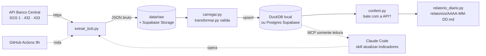

<div align="center">

# Projeto de Dados do Zero · 2026

**A IA escreve o código. As 12 decisões que fazem o projeto funcionar continuam sendo suas.**


</div>

---

## Sumário

1. [Sobre a aula](#1-sobre-a-aula)
2. [O que você vai construir](#2-o-que-você-vai-construir)
3. [Passo a passo](#3-passo-a-passo)
4. [O que faz cada lugar](#4-o-que-faz-cada-lugar)
5. [As 12 decisões](#5-as-12-decisões)
6. [O harness: o que fica em volta do agente](#6-o-harness-o-que-fica-em-volta-do-agente)
7. [MCP: ligar o agente aos sistemas](#7-mcp-ligar-o-agente-aos-sistemas)
8. [Local, on-premise ou nuvem](#8-local-on-premise-ou-nuvem)
9. [IDEs e agentes](#9-ides-e-agentes)
10. [Onde o projeto vive](#10-onde-o-projeto-vive)
11. [O dado real tem armadilhas](#11-o-dado-real-tem-armadilhas)
12. [Revisão: mapa do ecossistema](#12-revisão-mapa-do-ecossistema)
13. [Onde aprofundar na Jornada](#13-onde-aprofundar-na-jornada)
14. [Material da live](#14-material-da-live)

---

## 1. Sobre a aula

Em outubro de 2023 eu fiz ao vivo o workshop **"Como estruturar o seu projeto de dados do zero"**: 4h25 montando uma ETL na mão, com Git, ambiente virtual, testes, documentação e CI. O repositório daquela live é o [DataProjectStarterKit](https://github.com/lvgalvao/DataProjectStarterKit). Resumo em [`referencias/2023/`](referencias/2023/resumo-workshop-2023.md).

Em 2026 o agente de IA escreve o código. O desafio mudou:

| Problema de 2026 | Como aparece no dia a dia |
|---|---|
| **O agente esquece** | Cada conversa começa do zero se as regras não estiverem escritas. |
| **O agente tem a chave do carro** | Mexe em banco, CRM e planilha. Algumas ações não têm volta. |
| **O agente inventa número** | Com confiança. E as fontes de dados não batem entre si. |
| **Tudo é conexão** | O trabalho virou ligar sistemas, mais do que escrever código. |
| **Precisa rodar sem você** | Se depende de você abrir o notebook, não é projeto. |
| **Tudo tem custo** | Tokens, créditos e o seu tempo de revisão. |

A referência é o repositório que opera os lançamentos da Jornada de Dados: mais de 200 scripts, quase 30 skills e rotinas que rodam sozinhas, sem time de desenvolvimento. Este projeto é uma versão pequena dele, só com dado público.

## 2. O que você vai construir

Um **painel de indicadores operado por agente**. Todo dia ele puxa **dólar, Selic e IPCA** do Banco Central, guarda o bruto, valida, carrega num banco, confere os números e escreve um relatório curto do que mudou.



Exemplo do relatório gerado (`relatorios/2026-10-24.md`):

| Indicador | Último | Data | Anterior | Variação |
|---|---|---|---|---|
| Dólar comercial (venda), R$ | 5,0377 | 23/10/2026 | 5,0383 (22/10) | -0,01% |
| Selic meta, % a.a. | 13,75 | 24/10/2026 | 13,75 (23/10) | 0,00 p.p. |
| IPCA, variação mensal % | 0,82 | 01/09/2026 | -0,32 (01/08) | 1,14 p.p. |

Fonte: API SGS do Banco Central, consulta de 24/10/2026.

## 3. Passo a passo

### Pré-requisitos

| Ferramenta | Para quê | Instalação |
|---|---|---|
| **Terminal** | Onde tudo roda | Windows: [Git Bash](https://git-scm.com/downloads) · Mac/Linux: o padrão |
| **Git** + conta no **GitHub** | Versionar e publicar | [git-scm.com](https://git-scm.com/downloads) · [GitHub CLI](https://cli.github.com) |
| **uv** | Python, ambiente e dependências | [docs.astral.sh/uv](https://docs.astral.sh/uv/getting-started/installation/) |
| **Claude Code** | O agente | [claude.com/claude-code](https://claude.com/claude-code) |
| **Editor** | Ler e revisar o código | [VS Code](https://code.visualstudio.com), [Cursor](https://cursor.com) ou [Antigravity](https://antigravity.google) |

#### O que é cada uma e por que importa

**Terminal.** É a janela onde você digita comandos em texto, em vez de clicar. Todo o projeto roda dali: instalar, rodar a pipeline, testar, commitar.
*Por que importa:* o agente também trabalha no terminal. Cada vez que ele pede permissão para rodar um comando, é você quem aprova. Se você não sabe em que pasta está nem o que o comando faz, está aprovando às cegas. No Windows, use o Git Bash para que os comandos sejam os mesmos do Mac e do Linux.

**Git + GitHub.** O Git guarda o histórico do projeto: cada commit é uma foto do código num momento. O GitHub é onde essa história fica publicada, e também onde rodam o CI e a rotina diária (`.github/workflows/`).
*Por que importa:* é o seu botão de desfazer. O agente edita vários arquivos de uma vez. Com Git, você vê exatamente o que mudou (`git diff`) e volta atrás se não gostou. Sem Git, um erro do agente pode custar horas. O GitHub ainda serve de backup e de vitrine do projeto.

**uv.** Instala o Python na versão certa, cria o ambiente isolado do projeto e instala as dependências. Substitui `pyenv`, `venv` e `pip` com um comando só.
*Por que importa:* garante que o projeto roda igual na sua máquina, na do aluno e no GitHub Actions. A versão do Python está no `.python-version` e as versões exatas das bibliotecas estão no `uv.lock`. `uv sync` reproduz tudo. Por isso a regra do projeto é: dependência só entra com `uv add`, nunca com `pip install` solto.

**Claude Code.** O agente. Ele lê o código, edita arquivos, roda comandos e testes, e segue as regras do `CLAUDE.md`. Funciona no terminal, na IDE, no desktop e na web.
*Por que importa:* é quem faz o trabalho pesado. As outras quatro ferramentas existem para você controlar o que ele faz: o terminal mostra o que ele roda, o Git guarda o que ele mudou, o uv deixa o ambiente previsível e o editor deixa você ler o resultado.

**Editor.** Um programa para abrir e ler o código com cores, busca e árvore de pastas. VS Code é o padrão gratuito. Cursor e Antigravity são editores com IA embutida, mas também abrem o projeto normalmente.
*Por que importa:* o agente escreve, mas a responsabilidade é sua. Antes de commitar, você abre o arquivo, lê o diff e confere se faz sentido. Revisar é a parte do trabalho que não dá para delegar.

Para o modo local não precisa de conta nenhuma. Supabase só no passo B.

### A. Rodar no modo local (5 minutos, sem conta)

```bash
git clone https://github.com/lvgalvao/ProjetoDoZero2026.git
cd ProjetoDoZero2026
uv sync                                  # instala Python 3.13 e as dependências
uv run python -m scripts.rodar_tudo      # extrai, carrega, confere e gera o relatório
uv run pytest -q                         # 10 testes
```

Sem `.env`, o banco é um arquivo DuckDB em `data/painel.duckdb`. Abra o relatório em `relatorios/`.

Cada etapa também roda sozinha:

```bash
uv run python -m scripts.extrair_bcb        # API → data/raw/AAAA-MM-DD/serie_*.json
uv run python -m scripts.carregar           # valida e faz upsert; rejeitadas em data/rejeitados.json
uv run python -m scripts.conferir           # sai com erro se o banco não bater com a API
uv run python -m scripts.relatorio_diario   # escreve relatorios/AAAA-MM-DD.md
```

### B. Subir para a nuvem (Supabase)

1. Crie um projeto gratuito em [supabase.com](https://supabase.com).
2. Em **Project Settings › Database**, copie a connection string (modo *Session pooler*).
3. Copie o modelo e preencha:
   ```bash
   cp .env.example .env
   # DATABASE_URL=postgresql://...
   ```
4. Rode de novo: `uv run python -m scripts.rodar_tudo`. A saída mostra `modo nuvem (postgres)` e a tabela `indicadores` aparece no **Table Editor** do Supabase.
5. Opcional, para guardar o bruto na nuvem: crie o bucket `raw` em **Storage** e preencha `SUPABASE_URL` e `SUPABASE_SERVICE_KEY`. O JSON de cada dia vai para `raw/bcb/AAAA-MM-DD/`.

O código é o mesmo nos dois modos. Só muda uma linha do `.env`.

### C. Rodar sozinho todo dia (GitHub Actions)

1. Suba o repositório para o GitHub (`gh repo create`).
2. Em **Settings › Secrets and variables › Actions**, cadastre `DATABASE_URL` (e, se usar, `SUPABASE_URL` e `SUPABASE_SERVICE_KEY`).
3. Em **Actions › diario › Run workflow**, rode uma vez à mão.
4. A partir daí roda todo dia às 9h (Brasília) e salva o relatório do dia no repositório.

O `ci.yml` roda lint e testes em todo pull request: código vermelho não entra na `main`.

### D. Operar com o agente

```bash
claude
> atualiza os indicadores e me diz o que mudou
```

O Claude Code lê o `CLAUDE.md`, usa a skill `atualizar-indicadores`, roda a pipeline e responde com o número, a data e a fonte. Outros pedidos para testar:

- `> passa o revisor no último diff` (subagente que revisa e não edita)
- `> /validar` (lint, testes e conferência)
- `> apaga a pasta data` (o `settings.json` bloqueia)
- `> mostra o conteúdo do .env` (também bloqueado)

### E. Consultar o banco conversando (MCP)

1. No Supabase, crie um usuário só com `SELECT` na tabela `indicadores` e coloque a conexão dele em `DATABASE_URL_RO` no `.env`.
2. Abra o Claude Code na pasta: o `.mcp.json` liga o servidor `painel-ro` em modo somente leitura.
3. Pergunte: `> qual foi o maior dólar do último mês?`. O agente consulta o banco pelo MCP e não tem como alterar nada.

## 4. O que faz cada lugar

```
ProjetoDoZero2026/
├── CLAUDE.md                 # índice do projeto para o agente (lido em toda sessão)
├── prd.md                    # o que o projeto e a aula fazem; critérios de aceite
├── decisoes.md               # toda decisão confirmada, com data e porquê
├── HANDOFF.md                # onde a última sessão parou
├── README.md                 # este guia
├── pyproject.toml · uv.lock  # dependências (uv)
├── .python-version           # 3.13
├── .env.example              # nomes das chaves, sem valores
├── .gitignore                # .env, data/, vídeos ficam fora do git
├── .mcp.json                 # MCP: Postgres somente leitura
├── .claude/
│   ├── settings.json         # permissões (allow/ask/deny) e hooks
│   ├── agents/revisor.md     # subagente: revisa numa janela nova, não edita
│   ├── commands/validar.md   # /validar: lint + testes + conferência
│   └── skills/atualizar-indicadores/SKILL.md
├── scripts/
│   ├── comum.py              # caminhos, séries, banco (DuckDB ou Postgres)
│   ├── extrair_bcb.py        # API → JSON bruto (+ Storage)
│   ├── transformar.py        # conversão e regras do dado (o contrato)
│   ├── carregar.py           # valida e faz upsert
│   ├── conferir.py           # banco x API; erro se não bater
│   ├── relatorio_diario.py   # relatório do dia com fonte
│   └── rodar_tudo.py         # as 4 etapas em ordem
├── tests/                    # 10 testes, sem API nem banco real
├── relatorios/               # um relatório por dia
├── data/                     # local, fora do git: raw/, painel.duckdb, rejeitados.json
├── .github/workflows/
│   ├── ci.yml                # lint + testes em todo PR
│   └── diario.yml            # pipeline todo dia às 9h
├── apresentacao/index.html   # slides da live
├── material/                 # mapa do ecossistema (revisão)
└── referencias/              # workshop de 2023 e Agent Harness
```

| Lugar | Quem lê | Responde à pergunta |
|---|---|---|
| `CLAUDE.md` | o agente, em toda sessão | "O que vale sempre neste projeto?" |
| `prd.md` | você e o agente, antes de codar | "O que estamos construindo e quando está pronto?" |
| `decisoes.md` | o time e o agente | "Por que está assim?" |
| `HANDOFF.md` | a próxima sessão | "Onde paramos?" |
| `.claude/settings.json` | o Claude Code (imposto, não pedido) | "O que o agente pode fazer sem perguntar? O que é proibido?" |
| `.claude/agents/` | o agente, quando delega | "Quem revisa?" |
| `.claude/commands/` | você, quando chama `/validar` | "Qual é o ritual antes do commit?" |
| `.claude/skills/` | o agente, quando o pedido combina | "Como se faz esta tarefa que se repete?" |
| `.mcp.json` | o Claude Code ao abrir | "A que sistemas o agente se conecta, e com que permissão?" |
| `.env` | só os scripts | "Quais são as chaves?" (nunca o agente) |
| `scripts/` | qualquer um, com `uv run` | "Como gero esse resultado de novo?" |
| `tests/` | o hook, o CI e você | "Como sei que está certo?" |
| `.github/workflows/` | o GitHub | "O que roda sozinho, e quando?" |

## 5. As 12 decisões

### Parte 1: fundamentos que não mudaram

| # | Decisão | No projeto | O que você confere |
|:-:|---|---|---|
| 01 | Terminal e Git | `git init`, commits pequenos | Onde você está e o `git diff` antes de cada commit |
| 02 | uv e ambiente | `pyproject.toml`, `uv.lock`, `.python-version` | Dependência entrou com `uv add`; `uv sync` reproduz |
| 03 | Segredos | `.env`, `.env.example`, secrets do GitHub, `deny` no `.env` | Nenhuma chave no código nem no histórico |
| 04 | Todo script no repositório | `scripts/` com `uv run python -m` | Dá para gerar o mesmo resultado amanhã com um comando |

### Parte 2: o harness, os desafios de 2026

| # | Decisão | Pilar | No projeto | O que você confere |
|:-:|---|---|---|---|
| 05 | Spec antes do código | alinhamento | `prd.md` | O plano bate com o PRD; critério de aceite testável |
| 06 | Contexto | memória | `CLAUDE.md`, skill, `HANDOFF.md`, `decisoes.md` | A regra está escrita ou só "combinada"? |
| 07 | Conectar | ferramentas | API do BCB por script, MCP somente leitura | Cada conexão só tem a permissão que precisa |
| 08 | Permissões | execução | `settings.json` (`allow`/`ask`/`deny`) | Dá para desfazer? A proteção é imposta ou depende do agente lembrar? |
| 09 | Conferir o número | validação | `transformar.py`, `conferir.py`, testes, hook de `Stop`, `revisor` | De onde veio? Bate com outra fonte? O erro virou teste? |
| 10 | Onde o projeto vive | infra | DuckDB local ou Supabase | Rodar duas vezes não duplica; nada ficou público sem querer |
| 11 | Rodar sozinho | execução | `diario.yml` às 9h | Quando falha, alguém fica sabendo? |
| 12 | Custo e limite | infra | pipeline em script, agente só para operar e explicar | Tarefa repetida virou script ou continua gastando token? |

O detalhe de cada uma, com o problema real e a demo da live, está no [PRD](prd.md).

## 6. O harness: o que fica em volta do agente

**Harness é o sistema ao redor do modelo** (memória, ferramentas, execução e validação) que faz o modelo virar um agente que entrega. Ele começa antes da primeira linha de código. Referência: o workshop Agent Harness da área do aluno ([resumo](referencias/agent-harness/resumo-agent-harness.md), [repositório](https://github.com/caio-moliveira/workshop-agent-harness)).

| Pilar | Peça neste projeto | Por que existe |
|---|---|---|
| **Memória** | `CLAUDE.md`, `HANDOFF.md`, `decisoes.md`, skill | A janela de contexto é transitória; os arquivos lembram. |
| **Ferramentas** | scripts, `.mcp.json` somente leitura | O agente só alcança o que você ligou, e só com a permissão que você deu. |
| **Execução** | `settings.json` (`allow`/`ask`/`deny`), GitHub Actions | O que não tem volta não depende de o agente lembrar: é bloqueado. |
| **Validação** | testes, `conferir.py`, hook de `Stop`, subagente `revisor` | O agente não consegue dizer "pronto" com teste vermelho. |

Regras de bolso:

- **`CLAUDE.md`** para o que vale sempre; **command** para o ritual que você chama; **skill** para a competência que o agente carrega quando precisa.
- **Regra escrita** (no `CLAUDE.md`) o agente pode esquecer. **Regra imposta** (no `settings.json` e nos hooks) ele não consegue quebrar.
- **Revisor que conserta deixou de ser revisor.** O `revisor` lê o diff numa janela nova e devolve um parecer; quem conserta é quem fez.
- **Todo erro vira um sinal permanente:** uma regra, uma permissão negada, um hook ou um teste. Em 2023 era "todo bug vira teste"; a ideia é a mesma, ampliada.
- **Comece mínimo.** Este harness é pequeno de propósito. Ele cresce quando aparece um risco novo, não por reflexo.
- **`CLAUDE.md` é mapa, não manual:** até umas 200 linhas. Sem ele, o agente sai lendo tudo.
- **Plano fechado:** com PRD e tarefas definidas, quando algo falha o agente muda o código para caber no plano, e não o plano para caber no código.
- **Modelo razoável com bom harness ganha de modelo top com harness ruim.**

Do curso Agent Harness (vídeo de 28/06/2026, 3h47): resumo com os minutos de cada trecho, os erros que aconteceram ao vivo e as perguntas do público em [`referencias/agent-harness/resumo-agent-harness.md`](referencias/agent-harness/resumo-agent-harness.md).

Os hooks deste projeto (`.claude/settings.json`):

| Hook | Quando roda | O que faz |
|---|---|---|
| `PostToolUse` | depois de cada edição | formata e corrige o estilo com ruff |
| `Stop` | quando o agente quer terminar | roda ruff + pytest; se falhar, **bloqueia** e manda consertar |

## 7. MCP: ligar o agente aos sistemas

**MCP (Model Context Protocol)** é o padrão que liga o agente a sistemas externos (banco, CRM, Drive, GitHub) como ferramentas que ele pode chamar.

| Situação | Use | Por quê |
|---|---|---|
| Tarefa que se repete igual (extrair, carregar) | **script** | Barato, repetível, testável, roda sem agente |
| Pergunta nova sobre o dado ("qual foi o maior dólar do mês?") | **MCP** | O agente consulta na hora, sem você escrever SQL |
| Ação que escreve num sistema de produção | **script com confirmação** ou MCP com escrita só depois de "sim" | Ação sem volta não fica na mão do modelo |

Tipos de servidor:

| Tipo | Como roda | Exemplo |
|---|---|---|
| **Local (stdio)** | um programa na sua máquina, iniciado pelo Claude Code | `postgres-mcp` deste projeto (`.mcp.json`) |
| **Remoto (HTTP)** | um serviço na internet, com login (OAuth) | o MCP oficial do Supabase, o do GitHub, conectores do claude.ai |

Cuidados:

- **Somente leitura quando basta ler.** O `painel-ro` usa `--access-mode=restricted` e um usuário do banco que só tem `SELECT`. A proteção fica no banco, não no pedido.
- **A chave do MCP também fica no `.env`.** O `.mcp.json` usa `${DATABASE_URL_RO}` e vai para o git sem segredo.
- **Cada MCP ligado é uma porta aberta.** Ligue só o que o projeto usa.
- Para adicionar outros: `claude mcp add` (veja a [documentação do Claude Code](https://docs.claude.com/en/docs/claude-code/mcp)).

## 8. Local, on-premise ou nuvem

| | **Local** (seu computador) | **On-premise** (servidor da empresa) | **Nuvem** (Supabase, Vercel, Databricks) |
|---|---|---|---|
| Neste projeto | DuckDB em `data/painel.duckdb` | o mesmo código num servidor interno, com Postgres próprio | Postgres e Storage do Supabase, rotina no GitHub Actions |
| Custo | zero | servidor, energia, gente para manter | plano gratuito; paga conforme cresce |
| Quem mantém | você | o time de infraestrutura | o fornecedor |
| Quando usar | aprender, protótipo, dado que cabe na máquina | dado sensível que não pode sair, regra de compliance, custo previsível em grande volume | começar rápido, compartilhar, rodar sozinho, escalar |
| Risco | some se a máquina some; só você acessa | atualização e segurança por sua conta | configuração errada expõe dado (bucket público, chave vazada) |

O mesmo vale para o **modelo de IA**: API na nuvem (Claude, GPT, Gemini) para a maior parte dos casos, ou modelo aberto rodando local (por exemplo com Ollama) quando o dado não pode sair da empresa. O [agent-harness-prod](https://github.com/caio-moliveira/agent-harness-prod) do Caio troca entre os dois com uma variável de ambiente.

Regra de bolso: **comece local, suba para a nuvem quando precisar compartilhar ou rodar sozinho, e vá para on-premise quando a regra do dado exigir.** O código deste projeto não muda entre os três: muda o `.env`.

## 9. IDEs e agentes

**A IDE é gosto. O que mudou foi o agente.**

| Ferramenta | O que é | Quando faz sentido |
|---|---|---|
| **VS Code** | Editor gratuito com terminal e extensões | Padrão do mercado; roda o Claude Code no terminal ou pela extensão |
| **Cursor** | Fork do VS Code com IA embutida | Quem quer o assistente dentro do editor |
| **Antigravity** | IDE do Google com agentes | Usada na Trilha Python e na Trilha Claude Code da Jornada |
| **PyCharm / JetBrains** | IDE completa para Python | Projetos grandes, quem já usa |
| **Notebook (Jupyter, Databricks)** | Células com código e resultado | Explorar dado. Para produção, o código vai para `scripts/` |
| **Claude Code** | Agente no terminal (também em extensão de IDE, app desktop e web) | Construir e operar o projeto: lê, edita, roda e testa |
| **Outros agentes** (Codex, Gemini CLI) | Agentes de terminal de outros fornecedores | Os conceitos deste projeto valem igual: `AGENTS.md`/`CLAUDE.md`, permissões, testes |

## 10. Onde o projeto vive

| Necessidade | Ferramenta | Plano | Neste projeto |
|---|---|---|---|
| Banco | [Supabase](https://supabase.com) Postgres | gratuito | tabela `indicadores` (modo nuvem) |
| Arquivo bruto | Supabase Storage (compatível com S3) | gratuito | `raw/bcb/AAAA-MM-DD/` |
| Rodar todo dia | [GitHub Actions](https://github.com/features/actions) | gratuito em repositório público | `diario.yml` |
| Aplicação ou API | [Vercel](https://vercel.com) | gratuito | próximo passo: uma API FastAPI lendo `indicadores` |
| Warehouse e prova de conceito | [Databricks Free Edition](https://www.databricks.com/learn/free-edition) | gratuito | próximo passo: a mesma tabela com SQL warehouse e dashboard |

**Supabase para começar, Databricks para escalar, Vercel para expor.** Não precisa de AWS no dia 1. Atenção: Streamlit não roda bem na Vercel (precisa de servidor sempre ligado); para painel em Streamlit, use o Streamlit Community Cloud ou o Databricks Apps.

## 11. O dado real tem armadilhas

Conferido na API em 24/10/2026. São o centro do bloco 9 da live:

| O que a API faz | O que daria errado sem conferir | Como o projeto trata |
|---|---|---|
| Valor vem como **texto** (`"5.0377"`) | Somar texto, ordenar errado | `converter_valor` em `transformar.py` |
| Data vem como **texto DD/MM/AAAA** | Ordenar "01/09" antes de "23/08" | `converter_data` |
| **IPCA pode ser negativo** (`-0.32` em 08/2026) | Uma regra "valor > 0" descartaria um dado correto | negativo só é aceito no IPCA |
| **Selic meta vem com datas no futuro** (até a próxima reunião) | Relatório mostrando "hoje" um dado de daqui a 10 dias | data futura vai para `data/rejeitados.json` |
| A API pode falhar ou demorar | Pipeline para no meio sem aviso | timeout de 30 s e 3 tentativas |

Cada regra tem um teste em `tests/test_transformar.py`.

## 12. Revisão: mapa do ecossistema

O que é cada termo, quando usar, quando não usar e onde aprofundar: [`material/mapa-do-ecossistema.md`](material/mapa-do-ecossistema.md). Cobre design sprint, discovery, PRD, spec-driven, Git, uv, agente, harness, skill, hook, MCP, API, Postgres, Supabase, warehouse, lakehouse, medalhão, DuckDB, Databricks (Unity Catalog, Lakeflow, Spark, SQL Warehouse), Vercel, Lovable, CI/CD, Airflow, n8n, Docker, testes, gate, data quality, observabilidade, eval, RAG e agentes.

## 13. Onde aprofundar na Jornada

| Decisão | Trilha ou curso |
|---|---|
| 01 Terminal e Git | Curso Git e GitHub · Trilha Claude Code, Módulo 1 |
| 04 Script no repositório | Trilha Claude Code, Projeto 2 (Engenharia e Análise de Dados) |
| 05 PRD | Trilha Claude Code (PRD e Spec-Driven Development) · Trilha Databricks, Módulo 4 |
| 06 Contexto · 08 Permissões · 09 Validação | **Curso Agent Harness** · Desafio de Agosto, aula 3 (Harness Engineering) |
| 07 Conectar | Trilha Python, APIs · Trilha Engenharia de IA, Tools e MCP |
| 10 Onde vive | Trilha Databricks (Medalhão, Projeto completo) · Trilha Python, SQLAlchemy |
| 11 Rodar sozinho | Trilha Databricks, Lakeflow Jobs · Engenharia de Dados, Airflow |
| 12 Custo | Trilha Claude Code, "Os 8 Passos para Implementar Claude Code na Sua Organização" |

## 14. Material da live

- [PRD](prd.md): as 12 decisões, o roteiro de 3h30, os cuidados e as lacunas da área do aluno.
- [Apresentação](apresentacao/index.html): abra no navegador e use ← →.
- [Mapa do ecossistema](material/mapa-do-ecossistema.md).
- [Workshop de 2023](referencias/2023/resumo-workshop-2023.md) e [Agent Harness](referencias/agent-harness/resumo-agent-harness.md).

---

**Luciano Vasconcelos** · [Jornada de Dados](https://suajornadadedados.com.br) · dúvidas e sugestões nas [issues](https://github.com/lvgalvao/ProjetoDoZero2026/issues).
