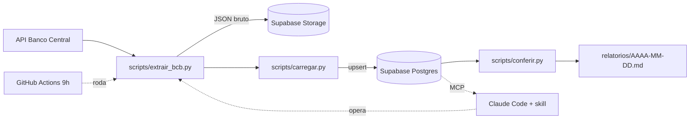

# PRD: Projeto de Dados do Zero 2026

**Versão:** 2, 24/10/2026. **Dono:** Luciano Vasconcelos (Jornada de Dados).
**Substitui:** a versão 1 (12 conceitos "de livro", com ruff, pre-commit e MkDocs no centro).
**Base:** o workshop "Como estruturar o seu projeto de dados do zero" (08/10/2023), resumido em `referencias/2023/resumo-workshop-2023.md`.

## 1. A ideia em uma frase

Mostrar como eu monto e opero um projeto de dados em 2026, com um agente de IA fazendo a maior parte do trabalho, e quais são os problemas de verdade que aparecem quando ele faz.

## 2. Por que refazer, e por que não do jeito de 2023

Em 2023 o desafio era **escrever** o projeto: ambiente, Git, testes, documentação, CI. Foram 4h25 ao vivo, tudo na mão.

Em 2026 o agente escreve. O desafio passou a ser outro:

- **O agente esquece.** Cada conversa começa do zero se as regras não estiverem escritas.
- **O agente tem a chave do carro.** Ele mexe em banco, CRM, anúncio e planilha, e algumas ações não têm volta.
- **O agente inventa número.** E as fontes de dados não batem entre si.
- **O trabalho virou conectar sistemas**, mais do que escrever código.
- **O projeto precisa rodar sem você.**
- **Tudo tem custo**: tokens, créditos, tempo de revisão.

A prova é o repositório que opera os lançamentos da Jornada: mais de 200 scripts, quase 30 skills, conexão direta com banco, CRM, mídia paga e área do aluno, e rotinas que rodam sozinhas de manhã e à noite, sem time de desenvolvimento. Não tem pre-commit nem MkDocs. Tem `CLAUDE.md`, regras de segurança, conferência de número e script salvo no repositório.

> Gancho: a IA escreve o código. O que separa um projeto que funciona de um que dá prejuízo são 12 decisões que continuam sendo suas.

**Esse conjunto tem nome: agent harness.** É o sistema ao redor do modelo, com **memória, ferramentas, execução e validação**, que faz o modelo virar um agente que entrega. A Parte 2 da live é a montagem do harness do projeto, um pilar por vez. Referência: o workshop Agent Harness da área do aluno (resumo em `referencias/agent-harness/resumo-agent-harness.md`).

Fio que liga 2023 a 2026: em 2023 a regra era "todo bug vira um teste". Em 2026 é **"todo erro do agente vira um sinal permanente"**: uma regra no `CLAUDE.md`, uma permissão negada, um hook ou um teste. O erro não pode voltar.

## 3. Público

Perfil dos 5.240 inscritos da Imersão Databricks + Claude Code (out/2026, questionário da LP):

| Pergunta | Resposta mais comum |
|---|---|
| Nível prático | 35% nunca escreveram código nem SQL; 26% só fizeram exercícios básicos; 7% já constroem pipelines |
| Cargo | 35% estudantes ou em transição; 26% analistas, BI ou cientistas; 18% dev ou TI; 12% gestores; 10% engenheiros de dados |
| Objetivo | 29% explorando; 22% promoção ou ir para engenharia; 18% portfólio para a 1ª vaga; 17% projeto para entregar na empresa; 13% freela ou consultoria |

Consequências para a live:

- Ninguém pode ficar para trás no terminal: o bloco 1 é mais lento.
- Os blocos de permissões (8) e de conferir número (9) são os que mais servem a quem não programa: exigem desconfiar, não codar.
- Tudo com linguagem de dia a dia ("o projeto roda em outra máquina?") e não de jargão ("lock file commitado?").

## 4. Resultado para o aluno

Três camadas, uma para cada grupo:

1. **Um projeto dele no GitHub, rodando sozinho todo dia** (quem explora e quem monta portfólio). Ele clona o modelo, segue a live e termina com o projeto no ar.
2. **O checklist das 12 decisões + o modelo de PRD e de `CLAUDE.md`** (quem quer promoção ou tem projeto na empresa). Para aplicar no projeto que já existe.
3. **O checklist como padrão de entrega** (freela e consultoria): o que o projeto precisa ter antes de você cobrar por ele.

**Critério de sucesso:** um aluno que nunca usou terminal consegue, sozinho, clonar o repositório final, colocar as chaves no `.env`, rodar a pipeline uma vez e ver o relatório do dia gerado.

## 5. O projeto prático: "meu painel operado por agente"

Uma versão pequena do repositório que opera a Jornada, só com dado público.

**O que faz:** todo dia puxa dólar, Selic e IPCA do Banco Central, guarda o bruto, carrega num Postgres, confere os números e escreve um relatório curto em Markdown dizendo o que mudou. O agente opera o projeto por uma skill: "atualiza os indicadores e me diz o que mudou".

**Por que esse caso:** API pública, sem chave, brasileira, dado que muda todo dia e que todo mundo entende. E tem armadilhas reais para o bloco 9 (conferidas na API em 24/10/2026): o valor vem como texto (`"5.0377"`), a data como texto `DD/MM/AAAA`, o IPCA pode ser negativo (`-0.32` em 08/2026) e a Selic meta já vem com datas no futuro (a meta vale até a próxima reunião).

**A mesma estrutura do repositório real:**

```
meu-painel/
├── CLAUDE.md                 # regras do projeto para o agente
├── PRD.md                    # o que o projeto faz e o critério de aceite
├── decisoes.md               # toda decisão confirmada, com data
├── HANDOFF.md                # onde a última sessão parou
├── .mcp.json                 # Supabase/Postgres somente leitura para o agente
├── .claude/
│   ├── settings.json         # permissões (allow/deny) e hooks
│   ├── agents/revisor.md     # revisa numa janela nova; não edita
│   └── skills/atualizar-indicadores/SKILL.md
├── scripts/
│   ├── comum.py              # séries, caminhos, banco (DuckDB local ou Postgres)
│   ├── extrair_bcb.py        # API → JSON bruto
│   ├── transformar.py        # conversão e regras do dado
│   ├── carregar.py           # bruto → banco (upsert)
│   ├── conferir.py           # os números batem?
│   ├── relatorio_diario.py   # escreve relatorios/AAAA-MM-DD.md
│   └── rodar_tudo.py         # as 4 etapas em ordem
├── tests/                    # 10 testes, sem API nem banco real
├── relatorios/
├── .github/workflows/diario.yml   # roda todo dia às 9h
├── .env.example
├── .gitignore
├── pyproject.toml
└── uv.lock
```



## 6. As 12 decisões

Para cada uma: o problema real (do repositório da Jornada), o que o aluno faz na live, como ele confere e onde se aprofundar na formação.

### Parte 1: fundamentos que não mudaram (40 min)

São rápidos de propósito. Continuam obrigatórios, mas não são mais o centro.

#### 1. Terminal e Git
- **Problema real:** o agente roda comando no terminal. Se você não sabe onde está nem o que ele vai rodar, aprova às cegas. E sem Git não tem como desfazer o que ele fez.
- **Na live:** abrir o terminal, criar a pasta, `git init`, primeiro commit, subir para o GitHub, abrir o Claude Code.
- **Confere:** `pwd`, `git status` e `git diff` antes de cada commit.
- **Na Jornada:** curso Git e GitHub (Introdução ao Git e GitHub e Repositórios Remotos); Trilha Claude Code, Módulo 1 (Setup).

#### 2. uv e ambiente
- **Problema real:** "na minha máquina funciona", agora também com o agente instalando pacote solto.
- **Na live:** `uv init`, `uv add`, `uv run`. Mostrar que outra máquina reproduz com `uv sync`.
- **Confere:** dependência entrou pelo `uv add`; `uv.lock` commitado.
- **Na Jornada:** lacuna (sem aula). Vídeo "Ambientes Virtuais com UV" do YouTube pode entrar.

#### 3. Segredos
- **Problema real:** um projeto de 2026 tem chave de banco, CRM, e-mail, mídia e IA. O agente, para "funcionar logo", cola a chave no código.
- **Na live:** `.env` e `.env.example`, `.gitignore` antes do primeiro commit, secrets do GitHub para a rotina.
- **Confere:** nenhuma chave no código nem no histórico do Git; o agente nunca imprime o valor de uma chave.
- **Na Jornada:** lacuna.

#### 4. Todo script fica no repositório
- **Problema real:** o agente resolve com um script temporário, funciona, e no mês seguinte ninguém sabe como aquele número foi gerado. A regra no repositório real: todo script que gera imagem, planilha ou análise fica em `scripts/`, nunca só na pasta temporária.
- **Na live:** pedir uma análise ao agente, ver onde ele salvou, mandar mover para `scripts/` e rodar de novo.
- **Confere:** dá para gerar o mesmo resultado amanhã com um comando.
- **Na Jornada:** Trilha Claude Code, Projeto 2 (Engenharia e Análise de Dados).

### Parte 2: o harness, os desafios de 2026 (2h30)

Cada decisão monta uma peça do harness:

| Pilar do harness | Decisões |
|---|---|
| Alinhamento (antes de tudo) | 5. PRD |
| Memória | 6. Contexto |
| Ferramentas | 7. Conectar |
| Execução | 8. Permissões · 11. Rodar sozinho |
| Validação | 9. Conferir o número |
| Infra e custo | 10. Onde vive · 12. Custo e limite |

Princípio: **comece mínimo**. O harness do painel é pequeno de propósito (um `CLAUDE.md` curto, um `settings.json`, uma skill, um revisor) porque um terço do público nunca programou. Cresce quando aparecer um risco novo.

#### 5. Spec antes do código: PRD
- **Problema real:** sem especificação o agente inventa requisito e você só descobre no fim. A maior falha não é o código, é o desalinhamento.
- **Na live:** escrever a ideia em 5 linhas, deixar o agente entrevistar você até fechar cada decisão (como a skill `grill-me`) e só então consolidar meia página de PRD (objetivo, fontes, saída, critério de aceite). Pedir um plano antes de qualquer código.
- **Confere:** o plano bate com o PRD; o que não está no PRD não entra; cada critério de aceite é testável ("o relatório sai às 9h", e não "melhorar o relatório").
- **Na Jornada:** Trilha Claude Code (aula de PRD e Módulo 4, Spec-Driven Development); curso Agent Harness; Trilha Databricks, Módulo 4 (requisitos, escopo e métricas).

#### 6. Contexto: `CLAUDE.md`, memória e skills (pilar memória)
- **Problema real:** o agente esquece tudo entre uma conversa e outra. A janela é transitória; os arquivos lembram. No repositório real, o `CLAUDE.md` guarda onde fica cada coisa e as regras que não podem ser quebradas, e cada tarefa repetida virou uma skill.
- **Na live:**
  - Escrever o `CLAUDE.md` do painel como índice curto: stack, comandos e uma seção "nunca quebrar".
  - Criar a skill `atualizar-indicadores`.
  - Mostrar a regra de bolso: **`CLAUDE.md` para o que vale sempre, comando para o ritual que você chama, skill para a competência que o agente carrega quando precisa.**
  - Fechar a sessão com um `HANDOFF.md`, abrir uma conversa nova e ver o agente continuar sem ninguém repetir nada.
- **Confere:** a regra está escrita ou só "combinada"? O `CLAUDE.md` cabe numa tela?
- **Na Jornada:** curso Agent Harness; Trilha Claude Code, Módulo 3 (Recursos Avançados).

#### 7. Conectar: APIs e MCP
- **Problema real:** o projeto não vive sozinho. O trabalho de 2026 é ligar o agente a banco, CRM, planilha e mídia, cada um com sua chave e seus limites.
- **Na live:** a API do Banco Central por script; o Postgres do Supabase pelo MCP em **modo somente leitura** (`.mcp.json`), para o agente ver o schema real antes de escrever SQL e consultar a tabela conversando.
- **Confere:** a conexão usa chave do `.env`; o MCP tem só a permissão que precisa (leitura quando basta ler).
- **Na Jornada:** Trilha Python, APIs; Trilha Engenharia de IA, Módulo 3 (Tools e MCP).

#### 8. Permissões: o que o agente pode fazer sozinho
- **Problema real:** algumas ações não têm volta. No repositório real há regras escritas para isso: nunca alterar campanha de outra pessoa, nunca fazer cadastro de teste no formulário (cria um negócio real no CRM), nunca trocar link que dispara evento de rastreamento sem aprovação (houve um incidente), sempre mostrar o diff antes de atualizar a planilha.
- **Na live:**
  - Separar o que é leitura (livre), escrita reversível (com confirmação) e escrita irreversível (proibida).
  - Escrever o perímetro no `.claude/settings.json`: `allow` para `uv run`, `git status` e `git diff`; `deny` para apagar a tabela, editar `data/` e mexer no `.env`.
  - Explicar a diferença entre a regra **escrita** no `CLAUDE.md` (o agente pode esquecer) e a regra **imposta** no `settings.json` (o agente não consegue).
  - Pedir ao agente algo proibido e ver o bloqueio.
- **Confere:** para cada ação: dá para desfazer? Quem é afetado se der errado? A proteção depende do agente lembrar ou é imposta?
- **Na Jornada:** curso Agent Harness; Trilha Engenharia de IA, Módulo 3 (Human in the Loop).

#### 9. Conferir o número
- **Problema real:** o agente entrega um número bonito e errado com toda a confiança. As fontes não batem (no lançamento, o pixel do anúncio conta cerca de 40% menos inscritos que o banco). Regras do repositório real: nunca inventar número; todo número com a fonte ao lado; cruzar fontes por uma chave (e-mail normalizado).
- **Na live:** em três camadas.
  - **Prova:** as armadilhas do Banco Central (texto no lugar de número, IPCA negativo que uma regra "valor > 0" descartaria, 11 datas futuras da Selic a cada extração); o `scripts/conferir.py` comparando o total carregado com o da API; um teste com pytest para a conversão. O teste entra como prova de que está certo, não como ritual.
  - **Gate:** um hook de `Stop` no `settings.json` que roda `conferir.py` e o `pytest` e **não deixa o agente dizer "pronto" com vermelho**.
  - **Revisor:** um subagente que lê o diff numa janela nova, que nunca viu a implementação, e devolve um parecer. Ele revisa e não conserta: revisor que conserta código deixou de ser revisor.
- **Confere:** de onde veio cada número? Bate com outra fonte? Rodar duas vezes dá o mesmo resultado? O erro de hoje virou teste ou regra para não voltar?
- **Na Jornada:** curso Agent Harness e Desafio de Agosto, aula 3 (Harness Engineering). O módulo "Pydantic, Data Quality e TDD" da Engenharia de Dados segue vazio.

#### 10. Onde o projeto vive
| Necessidade | Ferramenta | Por quê |
|---|---|---|
| Banco | Supabase Postgres | O Postgres do mercado, com painel e plano gratuito |
| Arquivo bruto | Supabase Storage | Compatível com S3 |
| Aplicação ou API | Vercel | Sobe com `git push` |
| Warehouse e PoC | Databricks Free Edition | Quando cresce ou precisa de Spark |

- **Na live:** carga com upsert no Supabase; mostrar a mesma tabela no Databricks como próximo passo.
- **Confere:** rodar duas vezes não duplica; o bucket não ficou público sem querer.
- **Atenção:** Streamlit não roda bem na Vercel. Na Vercel, FastAPI ou Next.js.
- **Na Jornada:** Trilha Databricks (Medalhão e Projeto completo); Trilha Python (SQLAlchemy e CRUD); Trilha Claude Code, Projeto 1 (deploy).

#### 11. Rodar sozinho
- **Problema real:** projeto que depende de você abrir o notebook não é projeto. No repositório real, rotinas rodam às 6h e às 20h e só entregam o relatório.
- **Na live:** GitHub Actions agendado todo dia às 9h, com as chaves nos secrets, gerando o relatório do dia. Mencionar as rotinas na nuvem do Claude como alternativa paga.
- **Confere:** quando falha, alguém fica sabendo? O que ela pode fazer sem aprovação?
- **Na Jornada:** Trilha Databricks, Lakeflow Jobs; Engenharia de Dados, Airflow.

#### 12. Custo e limite
- **Problema real:** token, crédito de ferramenta (no repositório real, cada mudança na LP gasta crédito do Lovable, ler o código é de graça) e, principalmente, o tempo de revisar o que a IA fez.
- **Na live:** quanto custou montar o painel; o que fazer por script (barato, repetível) e o que deixar para o agente (julgamento, texto). Quando não usar IA.
- **Confere:** a tarefa repetida virou script ou continua gastando token toda vez?
- **Na Jornada:** Trilha Claude Code, complemento ("Os 8 Passos para Implementar Claude Code na Sua Organização").

## 7. Roteiro da live (3h30)

| Tempo | Bloco | Duração |
|---|---|---|
| 0:00 | Abertura: o repositório que opera a Jornada (só estrutura) e 2023 x 2026 | 15 min |
| 0:15 | 1. Terminal e Git | 15 min |
| 0:30 | 2. uv | 10 min |
| 0:40 | 3. Segredos | 10 min |
| 0:50 | 4. Script no repositório | 10 min |
| 1:00 | 5. PRD | 15 min |
| 1:15 | 6. CLAUDE.md, memória e skills | 20 min |
| 1:35 | Intervalo | 10 min |
| 1:45 | 7. APIs e MCP | 20 min |
| 2:05 | 8. Permissões | 20 min |
| 2:25 | 9. Conferir o número | 20 min |
| 2:45 | 10. Onde o projeto vive | 15 min |
| 3:00 | 11. Rodar sozinho | 10 min |
| 3:10 | 12. Custo e limite | 10 min |
| 3:20 | Encerramento: checklist, ponte com as trilhas | 10 min |

## 8. Entregáveis

1. Repositório modelo `meu-painel` (template do GitHub) com uma tag por bloco (`bloco-01` … `bloco-12`).
2. Modelos de `PRD.md` e `CLAUDE.md` para copiar.
3. Checklist das 12 decisões, uma pergunta por decisão, em A4 com fundo branco.
4. Apresentação da live (`apresentacao/index.html`), com a ponte para a trilha no rodapé de cada bloco.
5. Prompts usados em cada demo, no README do repositório modelo.
6. Cortes da gravação por bloco, para preencher as lacunas da área do aluno.

## 9. Lacunas na área do aluno que a live preenche

| Decisão | Situação hoje | Destino sugerido |
|---|---|---|
| 2. uv | sem aula | Trilha Python, preparação do ambiente |
| 3. Segredos | sem aula | Trilha Claude Code, Módulo 1 |
| 8. Permissões | coberto pelo curso Agent Harness (3h48), que não está em nenhuma trilha | Colocar o curso Agent Harness na Trilha Claude Code |
| 9. Conferir o número | gate e revisor no Agent Harness; conferência de dado sem aula | Engenharia de Dados, "Pydantic, Data Quality e TDD" |

O curso Agent Harness é a ponte mais forte desta live, mas hoje está solto: não aparece em nenhuma trilha e o vídeo não tem transcrição gerada. Gerar a transcrição no Estúdio e colocar o curso numa trilha resolve as duas coisas.
| 11. Rodar sozinho | parcial | Engenharia de Dados, "DevOps" |

## 10. Cuidados

- O repositório da Jornada tem dado de cliente e chaves. Na live aparece só a estrutura de pastas e trechos do `CLAUDE.md` sem nomes, números de clientes ou IDs. Nunca o `.env`, tabelas, CRM ou contas de anúncio abertos.
- Contas criadas antes da live (GitHub, Supabase, Vercel, Databricks), chaves fora da tela.
- Ensaiar com o repositório zerado e ter a tag de gabarito de cada bloco: se travar, `git checkout bloco-07` e segue. Em 2023 quebraram ao vivo a versão do Python, o pre-commit e o CI.
- Testar o GitHub Actions no dia anterior.

## 11. Fora de escopo

Airflow, dbt, Kubernetes, AWS/GCP/Azure, machine learning, frontend, Docker (fica como bônus se sobrar tempo).

## 12. Decisões em aberto

- [ ] Caso prático: Banco Central (proposto) ou outro dado público.
- [ ] Rotina: só GitHub Actions ou mostrar também a rotina na nuvem do Claude.
- [ ] Quanto do repositório da Jornada mostrar na abertura.
- [ ] Data da live e se os cortes viram aulas na área do aluno.
